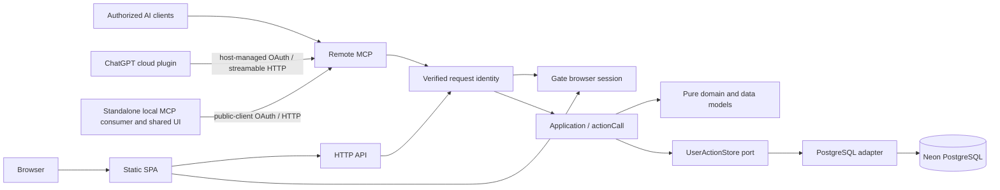

# Syntoria Weave architecture

## Service and runtime

Weave is Syntoria's independent shared-state service for people and authorized AI callers. TypeScript on Node.js 24 LTS runs in Fastify 5 on GCP Cloud Run; a dedicated Neon PostgreSQL 18 database stores durable state through pg and Drizzle migrations. HTTP API and Remote MCP share one application/domain/storage path. A separately hosted static SPA calls the API directly and reuses the same UI application as MCP UI resources.

Personal AI interprets intent, organizes work and decides what to do. Weave validates input and transitions, preserves original text, stores current state and protects revision, replay, Undo and authorization boundaries. Caller-side tools and schedulers own source collection, notifications and execution. Weave has no recommendation LLM or workflow engine. Thymesis is a separately deployed service with its own database, API, credentials, history and cursors; there are no shared business tables or distributed transactions.

## Responsibility boundaries

| Layer | Responsibility |
| --- | --- |
| lib/data/types.ts | Readonly contracts; declarations only |
| lib/domain/ | Pure transitions, containment, dates, order, flags, projection, Preview and Undo |
| lib/data/model/ | Pure request normalization, persisted DTOs, storage plans, receipt parsing, cursors and budgets |
| lib/application/ | Operation orchestration through store, clock and ID ports |
| lib/adapters/ | PostgreSQL SQL, transaction isolation, concurrency, receipts and failure recovery |
| lib/server/ | Node HTTP composition, authentication, authorization and request capabilities |
| lib/mcp/ and MCP entry | Tool discovery, JSON-RPC, resources and capability-checked dispatch |
| HTTP entry | API/MCP transport, session and Origin/content-type protection; it serves no SPA files |
| lib/ui/ | Pure UI state, explicit controller ports, DOM and transport adapters |
| web/ | Static SPA shell, runtime configuration loader, Gate login return and direct API relay |
| db/ and migrations | PostgreSQL schema, constraints and versioned migrations |
| build/ and scripts/ | Node/container build, execution, migration and verification |
| Infrastructure configuration | Cloud Run, secrets, IAM, database configuration and monitoring |

Pure code is deterministic and does not mutate inputs. DB, HTTP, DOM, host communication, clock and IDs are injected effects. UI components consume readonly models and explicit callbacks; rendering does not initialize or mutate application state. UI never connects directly to the database. HTTP and MCP share transitions and user-bound persistence. Verified identity binds every business SQL query to an explicit user; PostgreSQL RLS and connection-local identity settings are not used. Caller text is data, never executable policy or authorization.

A consumer reads current state before reconciling its context. Saved changes do not automatically update a caller LLM's context. Complete reads return a user-wide revision; filtered selections are not bootstrap snapshots. Perspectives are extraction definitions, not an independent management engine.

Operational topology, database guarantees and release requirements are defined in [infrastructure](docs/technical/infrastructure.md), [data model](docs/technical/data-model.md) and [deployment](docs/technical/deployment.md).

## Local MCP and ChatGPT plugin resources

The local stdio MCP server is an OAuth public client of the deployed Remote MCP service. It publishes the shared static business-tool definitions and serves the same generated UI HTML as `dist/spa/workspace.html`. MCP Apps UI calls reach this serving local server; it forwards the original business tool name and arguments to the configured HTTPS Remote MCP. It has no database connection, resource-client secret, browser-cookie fallback or alternate persistence path. Remote MCP remains independently usable.

Explicit issuer and resource endpoint configuration bind the local authorization state to one service. The local consumer dynamically registers its loopback callback with Gate and persists that registration separately from tokens. Gate authorization uses S256 PKCE. OAuth state is stored outside the install directory in a private SQLite database; transactions serialize token updates across processes and generation checks prevent a cancelled callback or stale response from restoring or erasing later authorization. Missing write responses remain unknown outcomes and are never automatically retried.

The standalone local MCP consumer is built under `dist/local` and serves the shared UI before forwarding business calls to Remote MCP. The ChatGPT personal package is generated from `plugins/action-tools/plugin.json`, `mcp.json` and `.app.json`. It requires the host-registered Remote MCP app through `.app.json` and leaves `mcpServers` empty, so it cannot create a duplicate connection. Its private marketplace root includes both operation skills, the shared UI resource, `LICENSE` and a hash inventory. It contains no local server, launcher, OAuth state or deployment endpoint settings. Generic builds have a template ID and no marketplace entry; configured builds require the exact host-issued app ID and use ignored renderer settings. The registration, package installation, tool refresh and new-chat resource refresh remain separate host observations. The standalone D1 adapter and its tests have no production composition or database-selection path.

## Action contract

Action is the product entity name. Relationships are parent-child containment only; there are no independent prerequisite edges, parallel/sequential modes or order-based execution restrictions.

Actions store a nonnegative integer sibling rank named order. Roots are ordered within a project or unassigned scope. Default creation and destination moves append; equal ranks use ID tie breaking. Reads emit parents before descendants. Direct flagged is a boolean with no inheritance. These attributes preserve lifecycle, Due and Defer.

- C1: ancestor Defer affects descendants' visibility without overwriting their own dates.
- C2: completing a parent atomically completes descendants; completing children never automatically completes the parent.
- C3: date-only Defer resolves 09:00 in the explicit request timezone to a saved UTC instant.
- C4: explicit on-hold remains unfinished and in normal view unless deferred.

Lifecycle is active/on-hold/completed/dropped. Read-time projection evaluates Defer without saving or reopening actions. Dropped records remain editable. Inbox projects all unfinished project-unassigned actions, including deferred ones. Order and Flag do not manufacture deadlines or commitments. Lifecycle records the person's decision about their work; a delegated process's run state is a separate record and does not drive it.

## Persistence and recovery

Neon PostgreSQL stores actions, catalogs, associations, identity markers and operation history. The PostgreSQL adapter acquires consistent snapshots and commits conditional revision validation, changed rows, receipt, delta and history pruning in one transaction. Writes for a user are serialized; reads create no records. Store only changed identities, never full-delete/full-save snapshots. Retain each user's operations for 30 days, never fewer than the latest 100 and never more than the latest 5000, for replay, Undo and the change feed. Each operation records, as provenance only, whether the person made it in the Weave app (browser session) or a client connection made it (bearer token), and which OAuth client committed it.

Writes require schemaVersion 2, an operation ID and current expectedRevision. Identical replay returns the saved result with current state; changed input is rejected before graph validation or ID allocation. Missing responses are unknown outcomes: retain exact IDs and arguments for lookup or identical replay. Undo preserves later unrelated corrections and rejects target conflicts. Complete snapshots and change windows share a consistent revision and retention fence; cursor order follows committed user revisions. Cursor scope includes the stable internal user and configured CURSOR_EPOCH; rotate the epoch on cutover/timeline restore and require a full resync.

## Authentication and authorization

Gate owns shared browser sessions and OAuth/OIDC connections. Every API bearer token or browser session is validated online with Gate, with no positive authorization cache. Session validation checks issuer, resource, expiry, approved device connection, session type and configured browser client. Browser sessions are never stored in Weave. The SPA sends cookie-authenticated API requests directly with credentials, exact registered Origin and Gate-provided CSRF token; credentialed CORS is restricted to configured SPA origins. Gate login is opened separately and its static return page sends only a refresh hint. The original SPA retains its mounted proposals, reads `/api/session` again and blocks writes if the account scope changed. MCP continues to use opaque bearer tokens and its independent OAuth authorization-code PKCE flow. Map verified subjects to stable internal users through an explicitly enabled issuer/subject mapping. Business arguments and public identity headers cannot select a user. SQL, receipts and history are user-scoped. Privileged storage access exists only behind the authenticated composition boundary. Logs exclude action text, personal data and credentials.

## Verification

Verify domain/application behavior, real PostgreSQL transactions, Node HTTP/MCP, deployed authorization, Web UI and each client integration separately. Test atomic failure, concurrent first and subsequent writes, replay, lost responses, Undo, user isolation, consistent snapshots and feed pagination. Record source, image digest, infrastructure configuration and deployment revision with evidence. See [testing](docs/technical/testing.md) and [deployment](docs/technical/deployment.md). Implementation and acceptance claims require evidence; architectural decisions do not establish deployed behavior.

## Saved perspectives

User-scoped perspectives persist versioned extraction conditions with a name and optional description for context. Version 1 stores the legacy filter; version 2 stores a structured query with optional global ordering. Pure domain evaluation uses the confirmed user snapshot at an explicit read time. Omitted sort preserves action-tree order; an explicit version 2 sort is global across matches. Definitions participate in the same consistent snapshot, atomic delta/revision/receipt and Undo transaction. Project/Tag references and deleted perspective identities are protected. list_perspectives and query_perspective expose the exact variant through the shared service. The shared UI provides Projects, Tags and saved Perspective browsing over the confirmed snapshot while retaining unsaved editor proposals. Explicit versioned summaries are visible; no query editor is provided.

The UI accepts persisted state only as a complete current snapshot with revision and actions, projects, tags and perspectives arrays. Partial replies retain the previous snapshot and exact pending request until verified. Action and catalog drafts validate their complete required Title or Name; no legacy blank-record exceptions apply.

The shared UI starts a local Action draft in every view without a persistence request. A valid nonempty Title, with complete valid edited fields and resolved parent/classification dependencies, commits one ordinary Action through the serial write lane. An explicitly selected visible persisted Action becomes the new Action’s parent and supplies its own project; an exact Tag occurrence contributes that direct Tag. Selected Project or Tag nodes supply direct classification, and no valid visible selection creates an unassigned root. Untouched drafts are removed when abandoned, including closing a catalog inspector; edited invalid or emptied proposals remain available until explicitly discarded. Explicit Add while a temporary object is selected discards that proposal before creating one replacement in its valid persisted parent/classification context. Pending or unknown persistence and protected dependent references block replacement rather than losing identity. Local identities never cross the API port. Confirmed generated UUIDs replace only identity and reference fields, preserving raw user text, newer proposals and the exact unknown request. Parent lifecycle and dates remain unchanged. Header Project/Tag drafts require valid nonempty names before distinct creation. Notes-only local proposals remain unsaved until a valid Title is supplied. Clearing a persisted Title retains an invalid local proposal without overwriting the saved value. Initial tag associations use the existing atomic delta/revision/receipt/Undo path.

The shared UI saves valid editor changes through a debounced, user-wide serial mutation lane. Blur and in-app navigation flush pending input; IME final text stays bound to its original Action. Routine changes use existing preview validation and immediate apply without a confirmation dialog. Only `action_move` uses direct apply at the latest user revision; server validation, receipts, Undo and complete snapshot replies remain on the common operation path. Captured proposal acknowledgment preserves newer input. Field baselines distinguish own confirmed writes from external corrections; overlapping edits require inline reconciliation. Unknown outcomes retain exact operations, and an applied receipt whose refresh fails keeps the lane gated until authoritative refresh.

`lib/ui/client.ts` composes the shared client with ordinary TypeScript imports. `scripts/generate-widget-client.mjs` bundles it as one self-contained IIFE and writes a generated module under the dependency cache before check, test and build. `lib/widget.ts` embeds that module in both normal and verification resources. The DOM adapter consumes read-only published application state and sends controller events; application ports own state changes and host calls. Action rows use occurrence keys to retain nodes across saving-only changes. Gesture coordinates share one queued animation frame and cached row geometry; effective edge scrolling invalidates geometry, and final drops resolve the latest coordinates before finishing.

The optional `UiDiagnosticsPort` counts list renders and movement fingerprints/intents only when the test resource explicitly opts in with `data-ui-diagnostics="true"`; the normal widget does not publish counters or action text. `lib/ui/effects/dom.d.ts` type-checks the TypeScript composition caller and mount-port shape. The adapter implementation remains JavaScript and is not internally type-checked by the current `tsconfig`; its read-only state rule is enforced separately by ESLint, while application interaction events remain a typed TypeScript union.

Action list movement uses one bounded `action_move` intent over a complete user snapshot. Selected roots move as a bundle; containment and destination sibling sequence change atomically while classification, lifecycle, own dates and subtree order remain unchanged. The pure planner includes hidden siblings, preserves source gaps and uses deterministic destination ranks. Existing CAS, delta, receipt and Undo apply unchanged. Direct status icons and Project/Tag assignment share the UI serial autosave lane; pointer/touch and keyboard chooser produce the same movement intent.

The UI lands on Now, a review of what waits on the person, recent changes by connected apps, flags and near deadlines; Changes lists retained saves newest first with per-save Undo. One view rail reaches every view: a sticky column of icon-only buttons with number badges beside the list on wide layouts, a labelled panel disclosed from the header title on narrow ones, and ending with Sign out when the host offers it; the header shows the current function name. On narrow layouts Action List and Action Detail are separate pages, and Back returns to the list position. Controls follow the [visual policy](docs/design/design-ui-visual-policy.md): icon-only where an icon suffices, without explanatory text. Action rows mark pending proposals, swipe on touch (right for Done and further for Dropped, left to ask AI) and lift for moving on a long press. Checked contextual display choices and icon-only Refresh share that header. Refresh sits at the far right and also exposes global save state through an accessible live description and the pure save-status projection’s state icon. Saved, waiting and writing states remain visually distinct when reduced motion disables animation; the button retains its Refresh action and accessible name. Unsettled states also show the projection’s label beside Refresh, so unknown outcomes and failures are distinguishable without reaching offscreen recovery messages. Animation runs only during actual writes. Header Add Project/Tag opens the matching tree and a temporary catalog inspector; same-view selection supplies its catalog parent, while a different view creates at the root. Add Action uses the explicit visible object context. Searchable Project/Tag pickers use stable catalog UUIDs and inline get-or-create; creation and optional assignment remain separate serial writes. Action-to-catalog drops use one atomic multi-Action classification operation. Native mouse and pointer/touch gestures share frozen intent, preserve list geometry during dragging and reuse the existing receipt/Undo path.

The shared widget applies complete, validated host safe-area insets on all four sides inside its assigned `100dvh` viewport. The flex workspace fills the resulting content area once, and the sticky header remains below the top inset while the document scrolls; a fixed backdrop protects that reserved band from scrolling content and input. Zero or absent insets preserve portable layout; malformed updates retain the last valid values. DOM and shared-model suites verify the resource contract; browser layout and actual client-device overlap require separate client acceptance.

Tree row edges and horizontal movement choose containment depth without a separate root drop region. A pure hit-intent model consumes adapter-supplied geometry and full semantic ancestry. Project and Tag movement change durable sibling order or parent through one ordinary atomic operation. Both catalog ranks use required order/name/UUID comparison; missing order is invalid. Catalog gestures are single-object and preserve Action membership.

Due and Defer share native date selection and an explicit 24-hour text clock. A first date selection defaults to 09:00 in the explicit client timezone. Complete numeric clock input is normalized for mobile entry; partial input remains an unsaved proposal. Custom seconds and milliseconds, saved UTC instants, and DST gap/fold rejection are preserved. Clearing Due saves null; explicitly clearing Defer releases it.

Action details show Title and Notes in view mode by default; the separate Action metadata text field is available through API/MCP and is not shown in Action Detail. A pure rich-text model turns a bounded Markdown subset—paragraphs with preserved single line breaks, headings, bullet, ordered and task lists, quotes, fenced code, rules, code spans, emphasis and links—into typed data, and the component builds DOM nodes from it without interpreting raw HTML. Only http, https and mailto destinations become links; other destinations stay literal text, and links open through the host `ui/open-link` request. Rendering never rewrites saved text. Collaboration cards render their proposal and report text through the same model. An explicit Edit control exposes the raw Title and Notes inputs; Done flushes the proposal and returns to view. A new local Action starts in edit mode, which follows it through identity confirmation. Edit mode belongs to the selected Action and ends on selection change, except that an invalid Title or Notes proposal stays editable until corrected.

Action lifecycle controls and the orange Flag control have a visual gap. Validation feedback is adjacent to the responsible editable fields with invalid/described-by semantics; conflict, unknown-result and transport recovery retain their separate existing controls. Date/time placeholders remain HH:mm without replacing partial raw input.

Projects and Tags require durable nonnegative safe-integer sibling order. Catalog outlines use order, then exact name and UUID. Both catalog kinds support relative before/after/inside/root moves through their existing atomic user-revision/receipt/Undo path. Tree-edge outdent preserves Action classification and does not add a separate drop area.

Interaction state is owned by the typed UI application boundary. Pure interaction, gesture and view transitions retain occurrence keys separately from unique Action IDs, validate related structure, correlate catalog acknowledgments, and preserve deferred composition intents, date proposals and picker/navigation state. Gesture context reuses prepared movement/tree indexes; pointer updates publish only the small interaction subtree and retain unchanged frozen view/draft references without rendering the list. The DOM adapter owns geometry, capture, animation frames, node/signature caches and focus effects. Keyed rows recursively reconcile changed attributes, text and handlers while retaining compatible child controls. Focus restoration uses `preventScroll`, including rows reinserted after a move. Composition input updates the retained draft under the application save gate, so an external correction remains a conflict until the user chooses a resolution.

The controller normalizes picker, date, movement and catalog acknowledgment state before publication. Rendering consumes pure row, inspector and chooser projections; explicit view effects apply focus and composer changes after rendering. Components receive DOM references and callbacks without access to the controller or host transport. Dependency lint enforces the physical UI layers, rejects common ambient effects in pure/application/component code, and keeps the public state data-only. The complete file tree, allowed dependencies and static-check limits are documented in [UI responsibility and dependency boundaries](docs/technical/ui-architecture.md).

## Shared work proposals and reports

The shared store also holds optional action-linked or new-work proposals, versioned business decisions, caller-reported progress, next actor, outcomes and immutable history. Pure collaboration transitions and the application service use the same user-bound PostgreSQL transaction and revision as actions. Adoption can create an action atomically; a report never changes its lifecycle. Snapshots expose collaboration heads while ordinary action deltas retain their five-collection contract.

Gate owns authentication and authorization. Accepted work scope is business intent, not an effect grant. Caller environments start and stop processes and enforce external-operation permissions. The service records requests and observations without a runner, scheduler or execution admission service. Unknown outcomes remain unresolved until a caller records observed evidence; records cannot guarantee an external process has stopped.

Remote MCP serves the stateless 2026-07-28 revision beside the initialize-based 2025 revisions on one endpoint. It exposes subscribable current-state and assigned-work resources: legacy clients subscribe and open bounded authenticated GET event streams, and 2026-07-28 clients open bounded `subscriptions/listen` POST response streams that store nothing. PostgreSQL holds connection-scoped legacy subscription metadata and durable business revisions; Gate revalidation controls delivery. Streams notify clients to reread state and do not run work. Each Action retains up to three proposal choices, with exclusive approval and cancellation that preserves the proposal.
