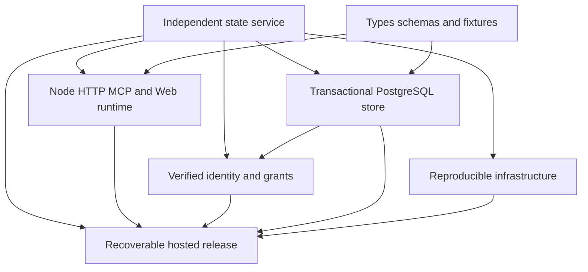

# Implementation plan

## Governing contracts

Use [architecture](../../../ARCHITECTURE.md), [service infrastructure](../../technical/infrastructure.md), [PostgreSQL contract](../../technical/data-model.md#postgresql-schema-and-transaction-contract), [release procedure](../../technical/deployment.md), [design](../../design/design-service-infrastructure.md) and [technical decision](../../adr/adr-20261018-backend-contracts.md). The following units are implementation work to perform after this design; no unit is marked implemented here.

## Outcome graph

Edges into Root's children describe inclusion; arrows between prerequisites and outcomes describe readiness dependencies. Each outcome has an independent acceptance boundary, not merely a workflow stage.

## Dependency-ordered units

| Unit | Owner / change surface | Prerequisites | Deliverable and acceptance |
| --- | --- | --- | --- |
| U1 Contracts and scalar codecs | lib/data/model, db/PostgreSQL schema and fixtures | Existing domain/API contract | Versioned PostgreSQL schema, exact text/ID codecs, bounds, deferred composite FKs and indexes. Pure round trips and schema constraint checks; no domain drift. |
| U2 PostgreSQL adapter | lib/adapters, application store port composition, storage suites | U1 | Checked-out-client reads, RLS/context, transaction advisory lock, receipt-first commit/CAS, changed rows and retention. Real PostgreSQL concurrency/failure/Undo/feed suite passes. Preserve the existing OwnerActionStore method contract. |
| U3 Node server and browser build | server bootstrap, HTTP/MCP entry, build/scripts, Web transport | U1; fake store for early transport tests, U2 for integration | Fastify routes, stateless MCP/notifications, Vite Web/UI assets, health, bounds, deadlines and SIGTERM. Compose through injected auth/store; no embedded mock auth in production artifact. Compare tools/resources and payload semantics. |
| U4 Identity and session boundary | lib/server auth/identity adapter, identity schema, Web auth routes | U1/U2, U3 HTTP hooks | Auth0 resource profile, jose token checks, openid-client PKCE callbacks, subject/client grants, expiring opaque sessions, CSRF and account-change recovery. Test real provider staging separately from unit JWT/session fixtures. |
| U5 Infrastructure and build/release automation | infra/Terraform, container, GitHub Actions, operational scripts | U3 artifact and U4 config contract | Declarative Cloud Run, Neon controls, Auth0 resource/client config, IAM/WIF, secret containers, Artifact Registry, jobs, buckets and monitoring. Validate redacted plans, resource/connection budgets and startup compatibility. No resource creation is implicit in design acceptance. |
| U6 Data transfer and cutover | administrative export/import/validation, migration/restore scripts | U1/U2/U4/U5 | Consistent write-fenced export/import; owner/subject binding, exact receipt/text/ID/ledger checks, stable resource identity and CURSOR_EPOCH reset. Rehearse failure before opening writes; prove no reset or dual writers. |
| U7 Hosted acceptance and restore | staging/prod release record, real PostgreSQL/HTTP/browser harness | U2–U6 | Source/image/config-bound API/MCP/Web and authorization acceptance, representative warm/cold timings, backup verification and monthly restore rehearsal. No generic MCP transport success is substituted for UI behavior. |

U2 and U3 may be developed independently after U1 through mock ports; their integration acceptance still requires the actual PostgreSQL/Node path. U5 can validate IaC/configuration before personal data transfer. U6/U7 remain prerequisites for production cutover.

## Required internal contracts

- `createServer({authenticate, actionCall, resources, uiAssets, health, deadlines})` owns Fastify composition. HTTP/MCP adapters normalize requests and translate responses; no transition logic lives in routes.
- `verifyRequest` returns an issued principal capability with owner, effective scopes and auth binding. Neither routes nor application callers cast raw claims into that capability. The identity adapter supplies revalidation at commit; do not inject Auth0/JWT SDKs into domain logic.
- `createOwnerBoundActionStore(pool, verifiedPrincipal)` captures owner and grant context once; every SQL statement uses it explicitly and transaction-local RLS. Store ports contain no pg client or transport objects.
- `readOperationState` captures raw receipt and snapshot sets then exposes synchronous lazy decoding. A missing/mismatched receipt is classified before validating the graph or allocating action IDs.
- `commit` uses one transaction client for owner lock, receipt recheck, revision CAS, delta writes, markers and pruning. A fresh read follows known success/replay; failure after COMMIT preserves the receipt and unknown client state.
- `changeCursorScope` takes verified owner and configured CURSOR_EPOCH at composition. Domain codec does not read environment or credentials.
- Build produces a Node entry and content-hashed Web assets with runtime licenses; production includes no mock identity or fixture endpoint. Integration fixtures use a separate test configuration/artifact.
- PostgreSQL migration runner uses a separate role, checksummed journal and transaction-scoped schema migration lock. API containers never run schema changes during scale-out.

## Release inputs versus design choices

Environment inputs: authorized GCP/Neon/Auth0 accounts/projects, exact PUBLIC_ORIGIN, issuer/client/resource identifiers, subjects/client grants, secret versions, backup bucket, alert recipients and cost thresholds. Resolve actual values before creating or publishing resources. They do not reopen Node/pg/Auth0/transaction/topology choices or imply permission to provision unrelated resources.

## Design review disposition

Main-session adversarial review checked empty-owner races, lock/snapshot ordering, duplicate-before-CAS precedence, replay after correction, retention, text/ID preservation, grant revocation, shared-pool/RLS context, connection surges, secret-bearing Terraform outputs, restored authorization and cursor rollback. Corrections are incorporated into the governing documents. This is self-review, not an independent review or implementation acceptance.
