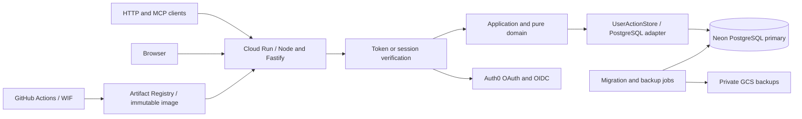

# Service infrastructure

## Runtime and topology

The service is TypeScript on Node.js 24 LTS, using Fastify 5 for HTTP, node-postgres (`pg`) for database connections, Drizzle PostgreSQL definitions/migrations, and Vite for the browser build. The package lock pins exact compatible versions during implementation. One immutable container serves HTTP API, stateless Remote MCP, the Web shell, static assets and UI resources. There is one application/domain path and one user-bound PostgreSQL adapter. No SSR or App Router runtime is required: the shared UI already owns rendering and state. Domain and UI state do not depend on Fastify, pg or an identity SDK.

Cloud Run uses the second-generation environment and request-based CPU. Listen on `0.0.0.0:$PORT` (default 8080 locally); TLS terminates at Cloud Run. Do not rely on instance memory for sessions, consumer positions or replay. On SIGTERM stop admission, drain at most 8 seconds, roll back incomplete transactions and close pools. A cut connection during COMMIT remains an unknown result. [Container contract](https://docs.cloud.google.com/run/docs/container-contract).

## HTTP boundaries

| Route | Contract |
| --- | --- |
| POST /mcp | Bearer-authenticated JSON-RPC over stateless Streamable HTTP; JSON responses, no sticky session |
| GET /mcp | 405; server-initiated SSE is not provided |
| DELETE /mcp | 405; there is no server session to delete |
| POST /api/actions | Same `{name,arguments}` service; bearer API or same-origin Web session |
| GET / | Web shell; sign-in screen when unauthenticated |
| GET /assets/<content-hash> | Public immutable assets containing no user data or secrets |
| GET /api/session | Cookie-authenticated session/account scope and CSRF token; no-store, same-origin only |
| GET /auth/login, GET /auth/callback, POST /auth/logout | OIDC login, one-time callback and CSRF-protected logout |
| GET /.well-known/oauth-protected-resource/mcp | Public MCP protected-resource metadata |
| GET /.well-known/oauth-protected-resource | Same metadata for discovery fallback |
| GET /health/live | Process health; no database query |
| GET /health/ready | Startup/schema compatibility state, no personal information |

MCP transport preserves supported 2025-03-26, 2025-06-18 and 2025-11-25 contracts, with 2025-11-25 as the default. Use explicit version validation and 400 for unsupported protocol headers; do not silently claim support for future versions. Notifications receive HTTP 202 without a JSON-RPC reply. Protect all /mcp methods, including initialize and discovery; metadata and health are public. UI resources carry no saved data and use the existing host transport when embedded. The browser Web adapter calls /api/actions with a session; the same UI application is reused in both contexts. [MCP transport](https://modelcontextprotocol.io/specification/2025-06-18/basic/transports).

Authenticate before invoking the private dispatcher. Reject invalid content type and malformed JSON at the HTTP boundary. Accept application/json and negotiate a JSON response for the MCP Streamable HTTP Accept profile. Preserve generic tool names, schemaVersion 2, resources and operation semantics. HTTP requests have a 1 MiB body ceiling; canonical mutation input remains 262,144 UTF-8 bytes and existing storage-plan budgets remain enforced. Large reads have no new truncation behavior. Responses containing state use Cache-Control: no-store. Never put bearer tokens in URLs or browser storage.

Origin/Host checks use configured PUBLIC_ORIGIN, never arbitrary forwarded host headers. Cookie writes require the exact configured Origin and CSRF token. Bearer calls without Origin are permitted; supplied Origins must be in the explicit allowlist. Do not combine cookie and bearer identities: reject mixed-credential requests. No wildcard credentialed CORS. Public metadata may use noncredentialed CORS. Browser integration requiring another origin must be explicitly configured and tested.

## Identity and access

Auth0 is the managed OAuth/OIDC authorization server. The application is a resource server and Web OIDC client; it does not implement an authorization server or proxy upstream tokens. Configure an API identifier equal to PUBLIC_ORIGIN + `/mcp`, enable Resource Parameter Compatibility Profile and issuer-in-authorization-response support, and use RS256 access tokens. The same resource represents HTTP and MCP access. Require standard resource-targeted tokens, not proprietary client assumptions. [Auth0 compatibility](https://auth0.com/ai/docs/mcp/guides/resource-param-compatibility-profile), [MCP authorization](https://modelcontextprotocol.io/specification/2025-11-25/basic/authorization).

Validate exact issuer, API audience, allowed signing algorithm, signature, exp/nbf, subject and client identity (Auth0 azp/client_id profile) with jose and configured issuer/JWKS. Fetch keys only from the configured issuer; never follow a token's arbitrary jku. Unknown keys cause one rate-limited JWKS refresh, then fail closed. Configure access-token lifetime to 15 minutes and maximum clock tolerance to 60 seconds. Unknown issuers, ID tokens used as API tokens, wrong audiences and expired tokens are rejected. Token introspection is not on the request path.

Use two scopes: `state:read` and `state:write`. Reads, discovery, resources, operation_status and preview require read; writes and Undo require read plus write. Check the published scope policy before dispatch as well as direct HTTP calls. Tool listing may omit unavailable writes, but hiding tools never replaces enforcement.

Store identity independently of action data:

| Table | Key / role |
| --- | --- |
| identity.subjects | (issuer, subject) unique; stable opaque user, enabled flag; no email identity matching |
| identity.client_grants | (issuer, subject, client_id); maximum read/write scopes and enabled flag |
| identity.sessions | SHA-256(session token); subject/client binding, expiry and last activity |
| identity.login_attempts | SHA-256(state); PKCE verifier encrypted with a Secret Manager key, nonce, browser-binding hash, relative return path and 10-minute expiry |

An authenticated read never creates a user or grant. Provision subjects and client grants using an audited administrative command before initial access; bind machine identities to one explicit user and client grant. No public signup, implicit account merging, user arguments or shared all-user service token. Client registration defaults to explicit preregistration with exact redirect URIs and PKCE S256. Dynamic registration is not a service dependency; supporting a client that needs it requires a separately configured Auth0 policy and explicit client grants. Publish only supported authorization metadata, never advertise unsupported registration features.

On each request, resolve the verified subject and client grant in PostgreSQL without a positive authorization cache. Missing/disabled mappings return 403; missing/invalid credentials return 401 with a protected-resource challenge. Grant revocation takes effect on the next request. A write rechecks enabled grant state inside its commit transaction; a grant revoked during an already-running transaction is not promised retroactive cancellation. Request-scoped capabilities bind user and effective scopes and cannot be constructed from business arguments.

Web login uses openid-client authorization code + PKCE, state and nonce. Bind the attempt to a separate Secure/HttpOnly/SameSite=Lax browser cookie and verify that binding on callback. Consume the attempt once, verify ID token/issuer/nonce, resolve an existing subject and Web client grant, and issue a 256-bit opaque session token. Store only its hash. Cookie is `__Host-action_session; Secure; HttpOnly; SameSite=Lax; Path=/`. Session absolute expiry is 8 hours and idle expiry 30 minutes; rate-limit last_activity updates to once per minute. Callbacks accept only configured redirect URI and relative non-auth return paths. No provider access/refresh token persists in the Web session. GET /api/session supplies a CSRF token derived as HMAC-SHA256 of the opaque session token using a versioned server CSRF key; validate it in constant time on every cookie-authenticated POST. This route also returns a non-reversible account-scope fingerprint so the UI can detect an account change without receiving raw subject/user identifiers. Logout deletes the session and clears the cookie. A sign-in expiry retains UI proposals and exact pending requests; after reauthentication verify account/user identity before resuming them.

The Web transport gates the save lane on 401 and opens reauthentication in a popup or separate tab while the original UI remains mounted. Callback completion emits only a same-origin BroadcastChannel completion signal on a random attempt channel; no token/identity is taken from that message. The original UI rereads /api/session and compares account scope before refreshing or resolving its retained exact operation. A different scope keeps the prior user's drafts isolated until explicitly discarded or the original account is restored. Do not redirect/reload the proposal-owning page or persist raw drafts in browser storage as an implicit reauthentication mechanism.

Identity records are accessed by fixed parameterized queries in the identity adapter, not the domain or caller. Session/login cleanup is bounded during auth traffic; stale records cannot authenticate. Runtime database credentials may access only required identity operations and user-scoped business tables. Migration and administration credentials are unavailable to the API container.

## Persistence

PostgreSQL 18 is the schema baseline. Use the primary direct TLS endpoint, hostname verification and a single pg pool per instance; use checked-out clients for whole transactions. There are no per-query HTTP driver transactions, read replicas, session-level advisory locks or unbounded pools. [pg transaction contract](https://node-postgres.com/features/transactions).

The [data model](data-model.md#postgresql-schema-and-transaction-contract) defines scalar mappings, indexes, transaction isolation and replay ordering. Application reads capture raw rows and receipts consistently, release the connection, then lazily decode the graph only after receipt input comparison. A mutation's prepared graph stays outside the write transaction; the adapter validates its revision again inside the transaction before storing changed rows. No DB connection is held during user interaction or external identity redirects.

## Resource configuration

These are initial operating values, not measured results. IaC validates configuration rather than assuming product-plan capabilities.

| Setting | Production | Staging / local |
| --- | --- | --- |
| Cloud Run region | asia-southeast1 (Singapore) | Same region / local Node |
| Neon region | aws-ap-southeast-1 (Singapore) | Separate staging project / PostgreSQL 18 |
| API CPU / memory | 1 vCPU / 512 MiB | Same for comparison |
| Service min / max instances | 1 / 3 | 0 / 1 |
| Request concurrency | 20 per instance | 20 |
| Cloud Run request timeout | 30 seconds | Same |
| Application deadline | 20 seconds; no new SQL after deadline | Same |
| pg pool max / idle timeout | 5 / 30 seconds | 5 / 30 seconds |
| Pool acquisition / connection timeout | 3 seconds / 3 seconds | Same |
| Statement / lock / idle-in-transaction timeout | 10 seconds / 3 seconds / 5 seconds | Same |
| Runtime DB role connection limit | 40 | 10 |
| Neon compute | 0.25 CU minimum, 1 CU maximum; no autosuspend | Scale to zero allowed |
| PITR window | 7 days, supported paid plan | 1 day minimum |

Neon's documented region list includes Singapore, not Tokyo; select this pair to keep API/DB close rather than assume a GCP-hosted Neon database. The project region is fixed at creation. [Region availability](https://neon.com/docs/introduction/regions). Do not change region by silently creating another production database. Production no-autosuspend and a warm API instance prioritize interactive latency; they have recurring costs. [Compute controls](https://neon.com/docs/manage/computes).

Budget for 2 simultaneous revisions x 3 instances x 5 connections = 30, plus up to 10 runtime surge connections, 2 migration/backup connections, and at least 22 administrative/provider-reserved connections. Require an actual effective database capacity of at least 64 and validate roles at deployment. Cloud Run max instances is not a hard connection bound during surges; the database role limit adds pressure control, and the database capacity plus bounded acquisition handle overflow. Role connection limits can also race, so do not claim a strict cross-instance mathematical cap. On exhaustion return retryable 503 without changing operation IDs. Do not raise max instances independently of DB capacity. [Cloud Run maximum instances](https://docs.cloud.google.com/run/docs/configuring/max-instances).

Cloud Run ingress accepts public HTTPS because OAuth clients are external. Cloud Run invocation is public at the platform layer; application authentication protects every data route. Exposing the socket does not make user data public. Use the service's stable run.app HTTPS URL as the initial canonical origin; no load balancer, NAT or private-network dependency is required. Exact URLs, GCP project, Neon project, Auth0 tenant/client IDs, backup bucket and account billing are deployment inputs, not unresolved architectural choices. Changing canonical origin also changes resource audience and redirect registration and requires coordinated client reauthorization.

## IaC and delivery ownership

Terraform owns GCP APIs, Artifact Registry, Cloud Run service/jobs, IAM, WIF trust, Secret Manager containers, GCS state/backup buckets, monitoring and Scheduler backup trigger. Provider versions are pinned. Remote Terraform state uses a private versioned GCS bucket with locking; bootstrap/import the state bucket once and never commit state. Terraform declares safe nonsecret Neon project/branch/compute and Auth0 API settings through pinned providers. Secret-bearing role/confidential-client creation and rotation use the reviewed idempotent bootstrap step described below; Terraform receives only public IDs and safe references. A missing provider capability is not permission to skip a required setting.

Secret values are installed as immutable Secret Manager versions outside Terraform state. Generated provider passwords/client secrets must not be output or put in shared plan artifacts; Neon/Auth0 provisioning that returns secrets goes through a redacting bootstrap step. Runtime service identity reads only explicitly referenced runtime secret versions. CI uses repository/environment/ref-bound GitHub OIDC WIF, not service-account JSON keys. Keep builder, deployer, migrator, backup and runtime identities separate. Deployer can update this service and act as these selected service identities, not project-wide impersonation. Backup identity can create backup objects; restore is an operator role, not an API capability. [Deployment federation](https://docs.cloud.google.com/iam/docs/workload-identity-federation-with-deployment-pipelines).

GitHub Actions stages are: checks and real PostgreSQL contracts; reproducible container build and Artifact Registry push; IaC plan with secret redaction; staging apply; one migration job; immutable-revision staging smoke; configured production-environment release; migration then traffic switch with rollback conditions. Never provision on a pull request that lacks trusted deployment context. Run migrations once as a dedicated Cloud Run job, protected by a PostgreSQL migration advisory lock and checksummed journal; API startup only checks compatibility. Revision updates pin secret versions and image digest. CI concurrency permits one environment release at a time.

## Resilience, monitoring and service objectives

Neon PITR is the short-term restore path. A nightly Cloud Run backup job, invoked by Cloud Scheduler with its own IAM service identity, also writes a consistent `pg_dump` of business and identity data to a private GCS bucket retained for 30 days. This is infrastructure backup automation, not a user workflow scheduler. Encrypt exports, deny public access, restrict readers and avoid action data in logs. Use an export role with explicit all-row SELECT policies on the RLS tables and read access to required identity tables, never runtime credentials. Use pg_dump --enable-row-security and verify exported counts, so FORCE RLS does not accidentally produce a partial backup or a failed dump. The runtime role cannot SET ROLE to the export role. Backup manifests include schema version, timestamp, row counts and object digest. [Neon restore](https://neon.com/docs/manage/branches).

Operational targets: recovery to the most recent completed logical backup has RPO <=24 hours and RTO <=60 minutes; PITR provides a nearer point when available, not an unmeasured zero-loss guarantee. Alert when backup age exceeds 26 hours or a job fails. Restore monthly into an isolated database; revoke imported Web sessions/login attempts, apply current subject/grant revocations before opening access, validate business/receipt/cursor integrity, and never serve a restored DB before those checks. Reconcile restored revisions with clients: invalidate the client cache/cursor epoch after rollback to an earlier timeline. Restore controls belong to the operator and require an explicit release record.

Capture request ID, route/tool name, status/error code, source/image/revision, duration, pool wait, transaction/SQL duration and response bytes. Do not log request bodies, canonical payloads, receipts, query parameters, authorization headers, cookies, subject strings or SQL bound values. Avoid user/operation IDs as metric labels. Optional Server-Timing on authenticated responses reports coarse server/DB durations without data values.

Engineering objectives for release validation: warm direct HTTP/MCP p95 <=300 ms for the 69-action representative fixture and <=1 second for 1,000 actions; each uses 60 or more measured requests after 3 warmups. Record cold-start p95 separately across at least 20 genuine restart/idle trials; initial objective <=3 seconds. These are new design targets, not achieved results or promises about client LLM scheduling, browser rendering or networks in Japan. Alert on 5xx >1% for 5 minutes (minimum 20 requests), sustained pool wait >500 ms and DB connection pressure >80%. Configure cost alerts at environment-provided monthly thresholds; alerts do not impose a spending cap.

## Cutover and verification

Follow [deployment](deployment.md) for a write-fenced, data-preserving import and release. Preserve API IDs, text, revisions, retained receipts, deltas and identity markers. Cursors bind the stable user and deployment CURSOR_EPOCH; cutover and timeline restoration rotate the epoch and explicitly require resynchronization. UI drafts and exact unknown operations survive reconnection. No dual-write path or cross-service transaction is introduced.

Required tests and implementation outcomes are in [testing](testing.md) and the [implementation plan](../changes/change-20261018-cloud-run-neon-infrastructure/implementation.md). The governing boundaries are in [service infrastructure design](../design/design-service-infrastructure.md). This design is not deployment or runtime acceptance evidence.
