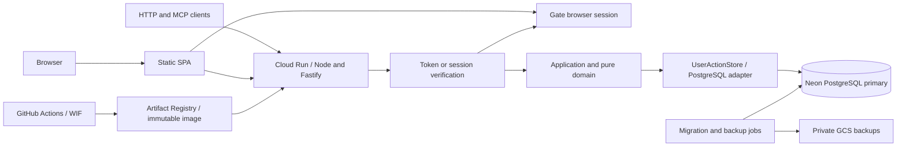

# Service infrastructure

## Runtime and topology

The service is TypeScript on Node.js 24 LTS, using Fastify 5 for HTTP, node-postgres (`pg`) for database connections, Drizzle PostgreSQL definitions/migrations, and Vite for the browser build. The package lock pins exact compatible versions during implementation. The API container serves HTTP API, stateless Remote MCP, health and OAuth metadata. A separate static SPA artifact contains the shared UI shell and widget resource. The SPA calls the API and Gate directly; the API does not serve SPA files. There is one application/domain path and one user-bound PostgreSQL adapter. No SSR or App Router runtime is required: the shared UI already owns rendering and state. Domain and UI state do not depend on Fastify, pg or an identity SDK.

Cloud Run uses the second-generation environment and request-based CPU. Listen on `0.0.0.0:$PORT` (default 8080 locally); TLS terminates at Cloud Run. Do not rely on instance memory for sessions, consumer positions or replay. On SIGTERM stop admission, drain at most 8 seconds, roll back incomplete transactions and close pools. A cut connection during COMMIT remains an unknown result. [Container contract](https://docs.cloud.google.com/run/docs/container-contract).

## HTTP boundaries

| Route | Contract |
| --- | --- |
| POST /mcp | Bearer-authenticated JSON-RPC over Streamable HTTP without sessions; JSON responses, and a bounded SSE response for 2026-07-28 `subscriptions/listen` |
| GET /mcp | Bounded SSE for subscribed legacy-revision clients; 405 for 2026-07-28 |
| DELETE /mcp | 405; there is no server session to delete |
| POST /api/actions | Same `{name,arguments}` service; bearer API or Gate shared-session cookie |
| GET /api/session | Cookie-only online Gate validation and account scope/CSRF token; no-store |
| GET `/.well-known/oauth-protected-resource/mcp` | Public MCP protected-resource metadata |
| GET `/.well-known/oauth-protected-resource` | Same metadata for discovery fallback |
| GET /health/live | Process health; no database query |
| GET /health/ready | Startup/schema compatibility state, no personal information |

The API exposes no `/`, `/assets/*`, per-product login/callback/logout or static UI routes. The separately hosted SPA includes the `workspace.html` frame, and the same UI resource remains available through MCP. Browser logout calls Gate directly.

MCP transport serves the 2026-07-28 revision statelessly and the 2025-03-26, 2025-06-18 and 2025-11-25 revisions through initialize, with 2025-11-25 as the legacy default; see [MCP entry points](mcp-api.md#entry-points-and-ownership). Use explicit version validation and the JSON-RPC unsupported-version error (400, -32022) for unsupported protocol headers; do not silently claim support for future versions. Notifications receive HTTP 202 without a JSON-RPC reply. Protect all /mcp methods, including initialize and discovery; metadata and health are public. UI resources carry no saved data and use the existing host transport when embedded. The browser Web adapter calls /api/actions with a session; the same UI application is reused in both contexts. [MCP transport](https://modelcontextprotocol.io/specification/2026-07-28/basic/transports/streamable-http).

Each request writes one structured log line: request ID, HTTP method, route, status, duration and DB wait/SQL time. For /mcp it adds, where present, the requested protocol version, JSON-RPC method, tool name, self-reported client name/version and declared extension identifiers, each restricted to its expected shape and otherwise `invalid` (`ambiguous` for repeated headers), and the JSON-RPC, tool or HTTP error code. Unexpected failures add only an error class with a system or SQLSTATE code. An event stream ending in a failure other than disconnection writes an `mcp_stream_error` line with the same cause. Logs never contain arguments, content, error messages, tokens or user data.

Authenticate before invoking the private dispatcher. Reject invalid content type and malformed JSON at the HTTP boundary. Accept application/json and negotiate a JSON response for the MCP Streamable HTTP Accept profile. Preserve generic tool names, schemaVersion 2, resources and operation semantics. HTTP requests have a 1 MiB body ceiling; canonical mutation input remains 262,144 UTF-8 bytes and existing storage-plan budgets remain enforced. Large reads have no new truncation behavior. Responses containing state use Cache-Control: no-store. Never put bearer tokens in URLs or browser storage.

Origin/Host checks use configured PUBLIC_ORIGIN, never arbitrary forwarded host headers. Cookie writes require an exact registered SPA Origin and a timing-safe match with Gate's CSRF token. Cookie reads with an Origin also require a registered SPA origin. Bearer calls without Origin are permitted; supplied Origins must be in the explicit allowlist. Reject duplicate wire-level Authorization, Cookie, Origin, CSRF, Content-Type and preflight headers, duplicate common session cookies, and mixed cookie/Bearer identities. Preflight is limited to known API routes, methods and `content-type`/`x-csrf-token`; credentialed CORS returns the exact configured origin and never `*`.

## Identity and access

Gate is the shared OAuth/OIDC authorization server for the user's software. Weave is a resource server for MCP and a direct-cookie API for its SPA. The MCP resource is exactly PUBLIC_ORIGIN + `/mcp`. Gate browser apps are registered separately from each resource's configured browser client ID. Login return URIs are exact registered static SPA URLs; a signed-in identity alone does not authorize a browser session until the user approves the device. No feature scopes or organizational roles are implemented.

The bundled Gate verifier discovers only the configured issuer and its same-origin HTTPS introspection endpoint. It authenticates introspection with the service's resource-client credential. Every API request validates its browser session online against the intended resource and checks issuer, subject, browser client, expiry, session type and approved connection ID. Every MCP request introspects its opaque Bearer token against the exact resource, expiry, approved connection and consistent dynamic client identity. There is no positive authorization cache or JWT fallback. Invalid/revoked credentials return 401, and Gate unavailability returns 503 without data access. Discovery metadata may be cached. Internal `state:read`/`state:write` capabilities are both issued after approval; they are not OAuth feature scopes.

Store identity independently of action data:

| Table | Key / role |
| --- | --- |
| identity.subjects | (issuer, subject) unique; stable opaque user, enabled flag; no email identity matching |
| identity.sessions, identity.login_attempts | Legacy migration-owned tables retained without runtime use; browser sessions and login transactions are Gate-owned |

An authenticated read never creates a user. Provision the exact issuer and verified subject to an existing stable internal user using the administrative command before initial access. No public signup, implicit account merging, user arguments or shared all-user service token. Public MCP clients use Gate's dynamic client registration endpoint exclusively, with exact redirect validation and PKCE S256. Registration creates a client identifier, never a user mapping or approved connection. Browser app and confidential introspection resource registrations remain separate operator settings.

On each request, resolve the verified issuer and subject in PostgreSQL without a positive authorization cache. Missing/disabled subject mappings return 403; missing/invalid credentials return 401 with a protected-resource challenge. Gate must confirm an approved, unexpired, nonrevoked connection for the intended resource. Dynamic client IDs remain part of principal/connection correlation, without a local client allowlist. Browser sessions additionally require the configured browser client ID. A write repeats Gate introspection and checks the enabled subject after acquiring the user lock inside its commit transaction. Revocation does not promise retroactive cancellation of operations whose final authorization check already completed. Request-scoped capabilities bind user and full-access capabilities and cannot be constructed from business arguments.

The static SPA loads an operator-rendered `/runtime-config.json` from its own origin with no-store caching. It contains only the API origin, Gate origin, registered browser app ID and exact static login return URI. The SPA opens Gate's `/browser/login` in a separate tab with those registered values; Gate reuses an approved session or performs one identity login and explicit device approval. The static return page contains no credential or identity and sends only a same-origin BroadcastChannel refresh hint. The initiating SPA rereads `/api/session`; its account-scope fingerprint keeps proposals bound to the original user. A 401 keeps the proposal-owning frame mounted and requires original-account recovery; a 503 reports authorization unavailability without prompting for another login. Network-uncertain writes retain the exact operation ID and arguments. The SPA sends direct API requests with `credentials: include`; writes require the registered Origin and Gate CSRF token. Browser logout calls Gate's bootstrap and logout endpoints with credentials and CSRF. The SPA's access bar appears only while sign-in, retry or account recovery needs the person; once signed in, the workspace frame's Sign out sends `web/sign-out`, which the SPA answers by running the same logout, and the SPA advertises it as `hostCapabilities.experimental.signOut`. Sessions are stored only by Gate and never persisted in Weave PostgreSQL. API revalidation occurs again inside the locked write transaction; Gate and PostgreSQL do not share an atomic revocation transaction.

Identity mappings are accessed by fixed parameterized queries in the identity adapter, not the domain or caller. The runtime uses only enabled-subject reads; it does not create, refresh or delete browser sessions/login attempts. Runtime database credentials may access the required identity operations and user-scoped business tables. Migration and administration credentials are unavailable to the API container.

## Persistence

PostgreSQL 18 is the schema baseline. Use the primary direct TLS endpoint, hostname verification and a single pg pool per instance; use checked-out clients for whole transactions. There are no per-query HTTP driver transactions, read replicas, session-level advisory locks or unbounded pools. [pg transaction contract](https://node-postgres.com/features/transactions).

The [data model](data-model.md#postgresql-schema-and-transaction-contract) defines scalar mappings, indexes, transaction isolation and replay ordering. Application reads capture raw rows and receipts consistently, release the connection, then lazily decode the graph only after receipt input comparison. A mutation's prepared graph stays outside the write transaction; the adapter validates its revision again inside the transaction before storing changed rows. No DB connection is held during user interaction or external identity redirects.

## Resource configuration

The production Neon database is `weave`. Its separate login roles are `weave_migrator`, `weave_runtime`, and `weave_backup`. The migrator owns application tables and runs versioned migrations without BYPASSRLS or superuser privileges. The application binds each business query to verified user identity; PostgreSQL RLS is disabled. The backup role has separate SELECT privileges. Connection URLs are stored in the corresponding `weave-*-database` Secret Manager resources; the API and jobs pin version 2. The database and role names are deployment resources, separate from schema and API identifiers.

These are initial operating values, not measured results. IaC validates configuration rather than assuming product-plan capabilities.

| Setting | Production | Staging / local |
| --- | --- | --- |
| Cloud Run region | asia-southeast1 (Singapore) | Same region / local Node |
| Neon region | aws-ap-southeast-1 (Singapore) | Separate staging project / PostgreSQL 18 |
| API CPU / memory | 1 vCPU / 512 MiB | Same for comparison |
| Service min / max instances | 1 / 3 | 0 / 1 |
| Request concurrency | 20 per instance | 20 |
| Cloud Run request timeout | 30 seconds | Same |
| Application deadline | 20 seconds; no new SQL after deadline | Same |
| pg pool max / idle timeout | 5 / 30 seconds | 5 / 30 seconds |
| Pool acquisition / connection timeout | 3 seconds / 3 seconds | Same |
| Statement / lock / idle-in-transaction timeout | 10 seconds / 3 seconds / 5 seconds | Same |
| Runtime DB role connection limit | 40 | 10 |
| Neon compute | 0.25 CU minimum, 1 CU maximum; no autosuspend | Scale to zero allowed |
| PITR window | 7 days, supported paid plan | 1 day minimum |

Neon's documented region list includes Singapore, not Tokyo; select this pair to keep API/DB close rather than assume a GCP-hosted Neon database. The project region is fixed at creation. [Region availability](https://neon.com/docs/introduction/regions). Do not change region by silently creating another production database. Production no-autosuspend and a warm API instance prioritize interactive latency; they have recurring costs. [Compute controls](https://neon.com/docs/manage/computes).

Budget for 2 simultaneous revisions x 3 instances x 5 connections = 30, plus up to 10 runtime surge connections, 2 migration/backup connections, and at least 22 administrative/provider-reserved connections. Require an actual effective database capacity of at least 64 and validate roles at deployment. Cloud Run max instances is not a hard connection bound during surges; the database role limit adds pressure control, and the database capacity plus bounded acquisition handle overflow. Role connection limits can also race, so do not claim a strict cross-instance mathematical cap. On exhaustion return retryable 503 without changing operation IDs. Do not raise max instances independently of DB capacity. [Cloud Run maximum instances](https://docs.cloud.google.com/run/docs/configuring/max-instances).

Cloud Run ingress accepts public HTTPS because callers are external. Cloud Run invocation is public at the platform layer; application authentication protects every data route. Exposing the socket does not make user data public. API origin, Gate issuer, SPA origins, browser redirects and shared cookie parent are runtime inputs; none are tracked in the repository or embedded in the API image. Changing any origin also changes the resource audience, browser CORS and registered redirects and requires coordinated operator verification.

## IaC and delivery ownership

Terraform owns GCP APIs, Artifact Registry, Cloud Run service/jobs, IAM, WIF trust, Secret Manager containers, GCS state/backup buckets, monitoring and Scheduler backup trigger. Provider versions are pinned. Remote Terraform state uses a private versioned GCS bucket with locking; bootstrap/import the state bucket once and never commit state. Neon settings and Gate registrations are explicit operator-managed prerequisites. Secret-bearing role/confidential-client creation and rotation use the reviewed idempotent bootstrap step described below; Terraform receives only public IDs and safe references. A missing provider capability is not permission to skip a required setting.

Secret values are installed as immutable Secret Manager versions outside Terraform state. Generated provider passwords/client secrets must not be output or put in shared plan artifacts; Neon/Gate provisioning that returns secrets goes through a redacting bootstrap step. Runtime service identity reads only explicitly referenced runtime secret versions. CI uses repository/environment/ref-bound GitHub OIDC WIF, not service-account JSON keys. Keep builder, deployer, migrator, backup and runtime identities separate. Deployer can update this service and act as these selected service identities, not project-wide impersonation. Backup identity can create backup objects; restore is an operator role, not an API capability. [Deployment federation](https://docs.cloud.google.com/iam/docs/workload-identity-federation-with-deployment-pipelines).

GitHub Actions stages are: checks and real PostgreSQL contracts; reproducible container build and Artifact Registry push; IaC plan with secret redaction; staging apply; one migration job; immutable-revision staging smoke; configured production-environment release; migration then traffic switch with rollback conditions. Never provision on a pull request that lacks trusted deployment context. Run migrations once as a dedicated Cloud Run job, protected by a PostgreSQL migration advisory lock and checksummed journal; API startup only checks compatibility. Revision updates pin secret versions and image digest. CI concurrency permits one environment release at a time.

## Resilience, monitoring and service objectives

Neon PITR is the short-term restore path. A nightly Cloud Run backup job, invoked by Cloud Scheduler with its own IAM service identity, also writes a consistent `pg_dump` of business and identity data to a private GCS bucket retained for 30 days. This is infrastructure backup automation, not a user workflow scheduler. Encrypt exports, deny public access, restrict readers and avoid action data in logs. Use an export role with explicit SELECT privileges on business and required identity tables, never runtime credentials. Use ordinary pg_dump and verify exported counts. The runtime role cannot SET ROLE to the export role. Backup manifests include schema version, timestamp, row counts and object digest. [Neon restore](https://neon.com/docs/manage/branches).

Operational targets: recovery to the most recent completed logical backup has RPO <=24 hours and RTO <=60 minutes; PITR provides a nearer point when available, not an unmeasured zero-loss guarantee. Alert when backup age exceeds 26 hours or a job fails. Restore monthly into an isolated database; browser sessions remain Gate-owned in Firestore and are not restored from PostgreSQL. Reapply current subject revocations before opening access, validate business/receipt/cursor integrity, and never serve a restored DB before those checks. Reconcile restored revisions with clients: invalidate the client cache/cursor epoch after rollback to an earlier timeline. Restore controls belong to the operator and require an explicit release record.

Capture request ID, route/tool name, status/error code, source/image/revision, duration, pool wait, transaction/SQL duration and response bytes. Do not log request bodies, canonical payloads, receipts, query parameters, authorization headers, cookies, subject strings or SQL bound values. Avoid user/operation IDs as metric labels. Optional Server-Timing on authenticated responses reports coarse server/DB durations without data values.

Engineering objectives for release validation: warm direct HTTP/MCP p95 <=300 ms for the 69-action representative fixture and <=1 second for 1,000 actions; each uses 60 or more measured requests after 3 warmups. Record cold-start p95 separately across at least 20 genuine restart/idle trials; initial objective <=3 seconds. These are new design targets, not achieved results or promises about client LLM scheduling, browser rendering or networks in Japan. Alert on 5xx >1% for 5 minutes (minimum 20 requests), sustained pool wait >500 ms and DB connection pressure >80%. Configure cost alerts at environment-provided monthly thresholds; alerts do not impose a spending cap.

## Cutover and verification

Follow [deployment](deployment.md) for a write-fenced, data-preserving import and release. Preserve API IDs, text, revisions, retained receipts, deltas and identity markers. Cursors bind the stable user and deployment CURSOR_EPOCH; cutover and timeline restoration rotate the epoch and explicitly require resynchronization. UI drafts and exact unknown operations survive reconnection. No dual-write path or cross-service transaction is introduced.

Required tests and implementation outcomes are in [testing](testing.md) and the [implementation plan](../changes/change-20261018-cloud-run-neon-infrastructure/implementation.md). The governing boundaries are in [service infrastructure design](../design/design-service-infrastructure.md). This design is not deployment or runtime acceptance evidence.
